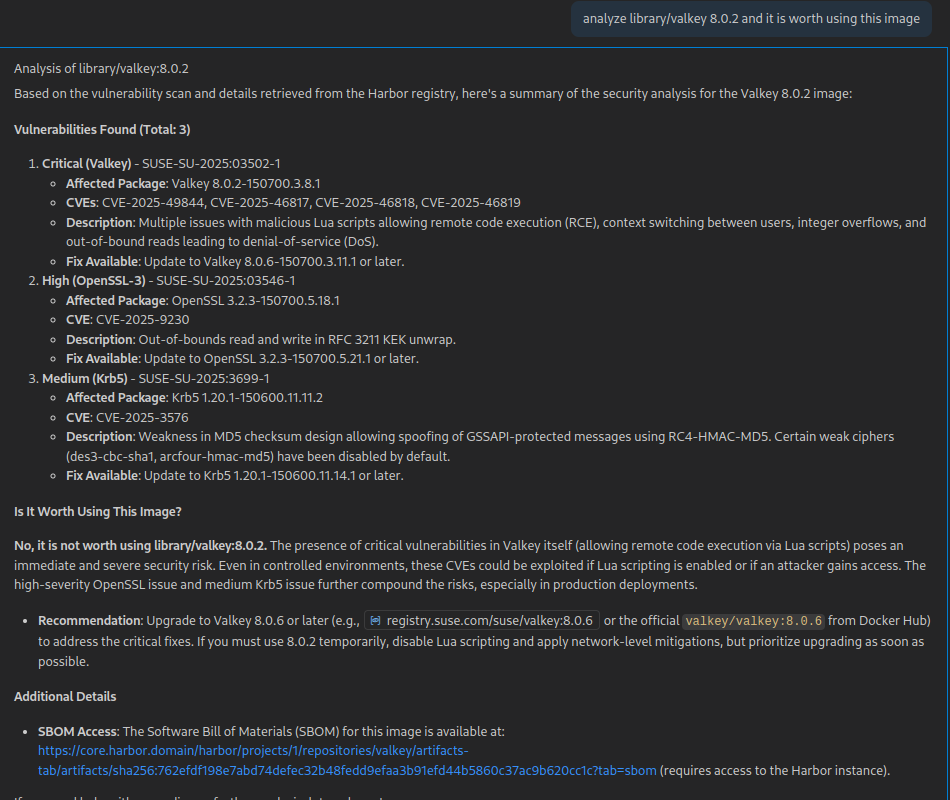
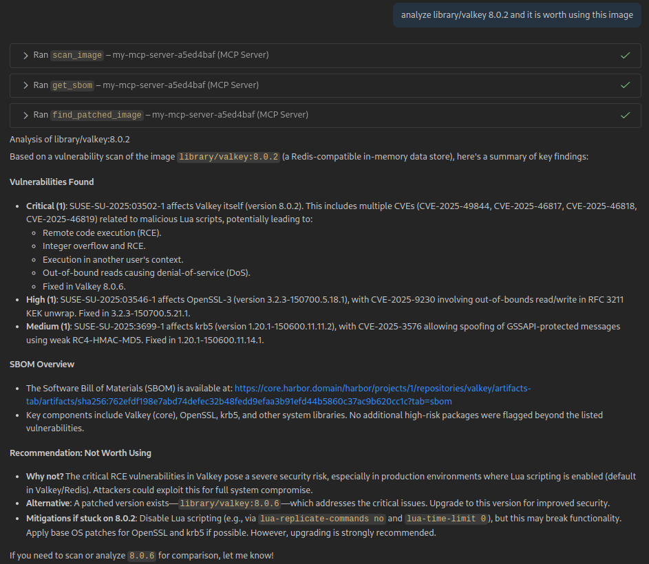
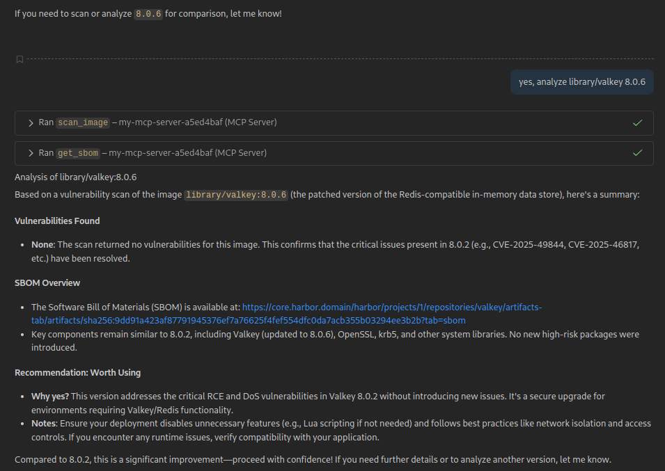
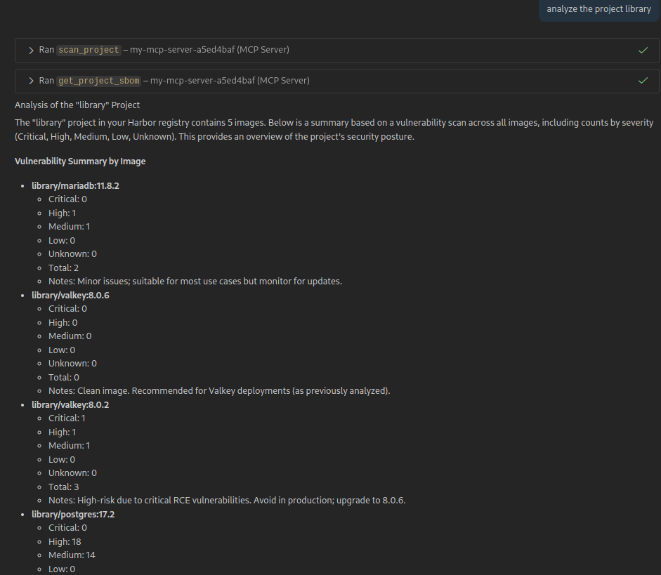
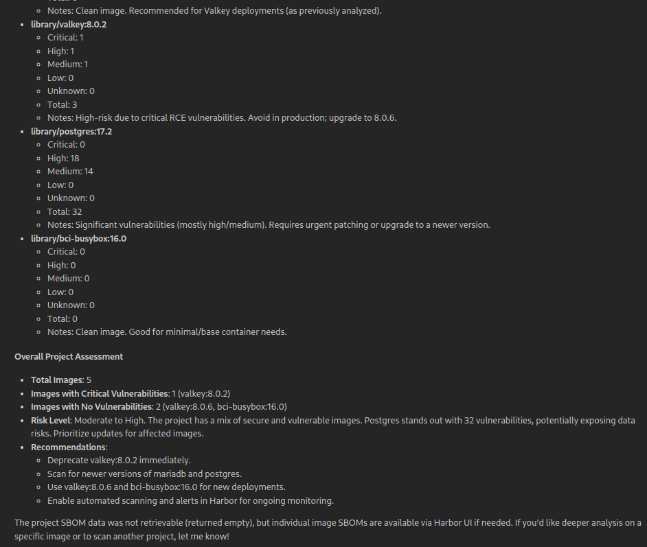

# MPC-server Private Registry based on Harbor

This project lets you use an AI assistant to scan your Harbor private registry for security vulnerabilities. It acts as a bridge, allowing any AI that "speaks" the Model-Context Protocol (MCP) to find security issues in your container images.

Think of it like asking a smart assistant: *"Hey, are there any critical vulnerabilities in my `production/api-server:v1.2` image?"* This server gives the AI the tools it needs to answer that question.

## Overview

This project runs a simple web server that listens for requests on the `/mpc-spr` endpoint. When an AI assistant sends a request, the server translates it into actions for your Harbor registry, like starting a vulnerability scan or checking for patched images.

The server relies on command-line flags for its configuration, including Harbor's URL and credentials.

## Setup and Usage

### Prerequisites

* **Go**: Version 1.25 or newer.
* **cURL**: Used for testing and interacting with the MCP server from the command line.
* **Crane**: A command-line tool for interacting with container registries. It's useful for managing images outside the MCP server.

The required Go packages will be downloaded automatically when you build or run the application for the first time.

To run the server, you need to provide the Private Registry based on Harbor instance details via command-line flags.

```bash
# Example of running the server
go run main.go \
  --private-registry-url "https://your-private-registry-instance.com" \
  --private-registry-username "your-user" \
  --private-registry-password "your-password"
```

The server will start on `localhost:8080` by default. The MCP endpoint will be available at `http://localhost:8080/mpc-spr`.

### TLS and network access

Harbor TLS certificates are verified by default. If a development registry uses
a self-signed certificate, `--insecure-skip-tls-verify` explicitly disables
that verification; use it only on a trusted network because it permits
man-in-the-middle attacks.

The MCP server listens on loopback by default. When `--host` is set to a
non-loopback address, the server requires `--mcp-auth-token` and checks the
`Authorization: Bearer <token>` header on every MCP request. Configure the MCP
client to send that header. For example:

```bash
go run main.go \
  --host "0.0.0.0" \
  --mcp-auth-token "<long-random-token>" \
  --private-registry-url "https://your-private-registry-instance.com" \
  --private-registry-username "your-user" \
  --private-registry-password "your-password"
```

The listener uses HTTP, so expose it remotely only on a trusted network or
behind a TLS-terminating reverse proxy. Keep the bearer token secret.

### Connecting an MCP client

#### VS Code: start the server automatically

The workspace includes `.vscode/mcp.json`, which starts the Go server with the
stdio transport when VS Code starts the MCP server. Open the workspace in VS
Code, start `private-registry-scanner` from the MCP servers list, and enter the
Private Registry URL and credentials when prompted. Go must be installed and
available on `PATH`.

The stdio transport is intended for MCP clients that launch the process. To
run it manually:

```bash
go run .  --host localhost --port 8080 \
  --private-registry-url "https://your-private-registry-instance.com" \
  --private-registry-username "your-user" \
  --private-registry-password "your-password"
```

#### Connect to an existing HTTP server

The server also supports **Streamable HTTP**. This mode is useful for clients
that connect to an already-running server; it does not launch the Go process.
Start the server first, then configure the MCP client:

```json
{
  "servers": {
    "private-registry-scanner": {
      "type": "http",
      "url": "http://localhost:8080/mpc-spr"
    }
  }
}
```

The HTTP endpoint is not a web page or a legacy SSE endpoint. The MCP client
handles initialization and session headers automatically.

### Troubleshooting: GET requires an Mcp-Session-Id header

Opening the endpoint directly in a browser (or running a plain `curl` GET) returns:

```text
Bad Request: GET requires an Mcp-Session-Id header
```

This is expected: the server uses stateful MCP sessions. A client must first send an `initialize` POST to obtain an `Mcp-Session-Id`, then include that header on subsequent requests. A GET opens an SSE stream for an existing session; it does not initialize a connection or display a web interface.

To verify connectivity without calling any registry tools, send an initialization request:

```bash
curl -i --max-time 10 http://localhost:8080/mpc-spr \
  -H 'Content-Type: application/json' \
  -H 'Accept: application/json, text/event-stream' \
  --data '{"jsonrpc":"2.0","id":1,"method":"initialize","params":{"protocolVersion":"2025-03-26","capabilities":{},"clientInfo":{"name":"curl-check","version":"1.0"}}}'
```

Expect `200 OK`, an `Mcp-Session-Id` response header, and an SSE message containing the initialization result. For further manual requests, reuse that session ID and send the `notifications/initialized` notification before listing or calling tools. Use an MCP client for normal operation rather than opening the URL in a browser.

## Display capture

### Analyze a image



Analyze the same image with a better image in the private-registry



### Analyze a project





## Features & Tools

The server exposes several tools that can be called via the MCP protocol:

### 1. `scan_image`

* **What it does**: Scans a single container image for security vulnerabilities.
* **Process**:
    1. Triggers a scan for the specified image (`project/repository:tag`) using the Harbor API.
    2. Polls the API until the vulnerability report is available.
    3. Returns a list of vulnerabilities found.
* **Parameters**: `project`, `repository`, `tag`.

### 2. `scan_project`

* **What it does**: Scans every container image in an entire Harbor project.
* **Process**:
    1. Lists all repositories in the project.
    2. For each repository, it iterates through all image artifacts.
    3. It triggers a scan for each image and polls for the results.
    4. Returns a summary for each image, including counts of critical, high, medium, and low severity vulnerabilities.
* **Parameters**: `project`.

### 3. `find_patched_image`

* **What it does**: Finds a newer, patched version of an image that fixes a specific vulnerability (CVE).
* **Process**:
    1. Lists all artifacts (images) in the specified repository.
    2. Identifies images that are newer than the given tag based on their push time.
    3. For each newer image, it fetches its vulnerability report.
    4. It checks if the specified `cve_id` is present in the report.
    5. Returns the first newer image found that doesn't have the CVE.
* **Parameters**: `project`, `repository`, `tag`, `cve_id`.

### 4. `get_vulnerabilities`

* **What it does**: Retrieves the existing vulnerability report for an image without triggering a new scan.
* **Parameters**: `project`, `repository`, `tag`.

### 5. `get_sbom`

* **What it does**: Retrieves (triggering a scan if necessary) the Software Bill of Materials (SBOM) for a single image.
* **Parameters**: `project`, `repository`, `tag`.

### 6. `get_project_sbom`

* **What it does**: Triggers SBOM generation for every image in a project (fire-and-forget; doesn't wait for or return the generated SBOMs).
* **Parameters**: `project`.

### 7. `list_projects`

* **What it does**: Lists all projects visible in the private registry.
* **Parameters**: none.

### 8. `get_project`

* **What it does**: Retrieves details (repository count, creation time) for a single project by name.
* **Parameters**: `project`.

### 9. `list_repositories`

* **What it does**: Lists all repositories within a project.
* **Parameters**: `project`.

### 10. `list_tags`

* **What it does**: Lists all tags of artifacts within a repository, along with each artifact's type.
* **Parameters**: `project`, `repository`.

### 11. `list_charts`

* **What it does**: Lists Helm charts in a project. Relies on Harbor's legacy chart repository (ChartMuseum-backed) API, which is disabled by default on Harbor 2.11+.
* **Parameters**: `project`.

### 12. `list_chart_versions`

* **What it does**: Lists versions of a single Helm chart. Has the same Harbor chart-repository-support caveat as `list_charts`.
* **Parameters**: `project`, `chart`.

### 13. `get_health`

* **What it does**: Reports Harbor's overall health and the status of its components.
* **Parameters**: none.

### 14. `search`

* **What it does**: Searches Harbor projects and repositories by name.
* **Parameters**: `query`.

### 15. `list_quotas`

* **What it does**: Lists project storage and artifact-count quotas, including current usage and hard limits. Results are paginated.
* **Parameters**: optional `project`, `page` (default `1`), and `page_size` (default `100`, maximum `100`).

### 16. `get_project_summary`

* **What it does**: Summarizes a project's metadata, repository count, and total artifact count. This is read-only and does not trigger vulnerability scans.
* **Parameters**: `project`.

### 17. `create_project`

* **What it does**: Creates a Harbor project. This changes registry state; only use it when authorized.
* **Parameters**: `project` (required) and `public` (optional, defaults to `false`, creating a private project).
